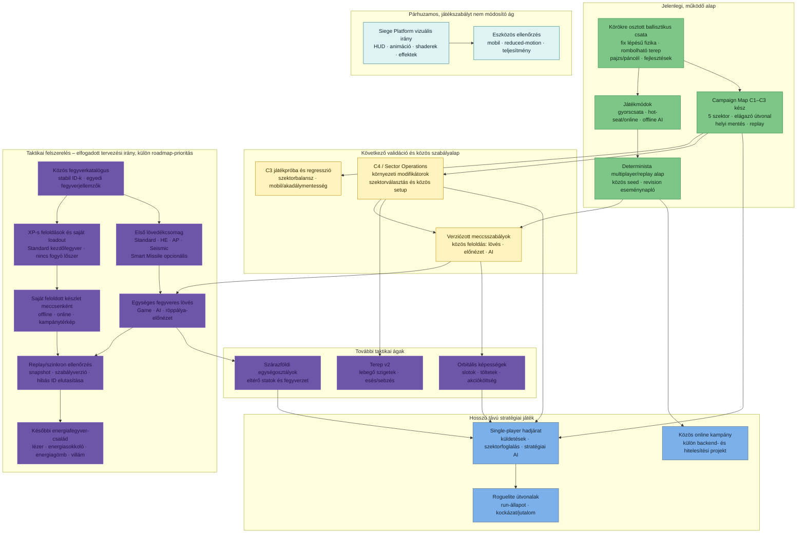

# Játékmenet-fejlesztési útvonal

Ez az ábra a jelenlegi játékmeneti alapot és a tervezett fejlesztési ágakat
mutatja, a fő függőségekkel. Nem dátumozott ütemterv és nem vállalt
végrehajtási sorrend: a központi státuszt a [roadmap](./roadmap.md), a részletes
progressziós és fegyvertervet a [gameplay-elemzés](./gameplay-progression.md)
és a [végrehajtási TODO](./gameplay-progression-todo.md) tartalmazza.

## A diagram olvasása

- **Zöld:** megvalósított alap. A Campaign Map C3 működik, de további
  játékpróba és eszközös ellenőrzés még szükséges.
- **Sárga:** következő validációs/közös szabályalap; a C4 és a verziózott
  konfiguráció részletes döntései még nyitottak.
- **Lila:** tervezett taktikai bővítés. A fegyvereknél az alapelvek és több
  döntés elfogadott, de az implementáció és a központi roadmap-prioritás még
  nincs jóváhagyva.
- **Szürke:** hosszú távú stratégiai irány, külön specifikációt igényel.
- **Türkiz:** a gameplay-szabályoktól elkülöníthető vizuális és eszközminőségi
  munka.

A fegyvercsomagban minden fegyver saját alapkarakterisztikát kap; a játékos
Standard Shell-lel indul, további fegyvereket XP-ért old fel, és a saját
feloldott készletét viszi offline, online és kampánytérképes meccsre. A
Robbanófej upgrade ettől különálló marad. Fegyverenként külön XP-fejlesztési ág
nem része az első csomagnak; később csak új taktikai döntést adó fejlesztés
indokolt.
